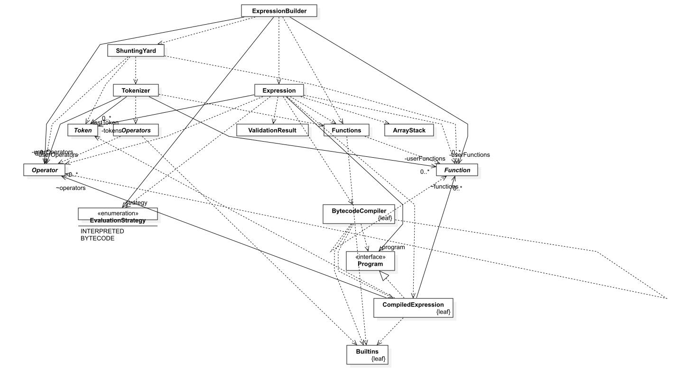
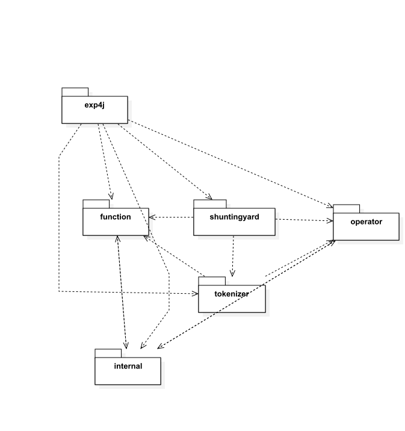
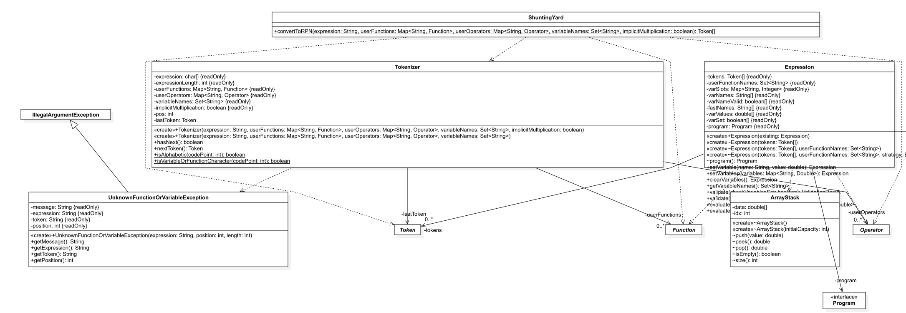
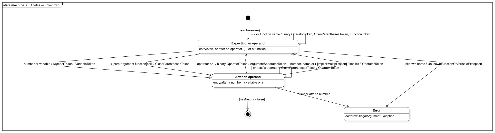
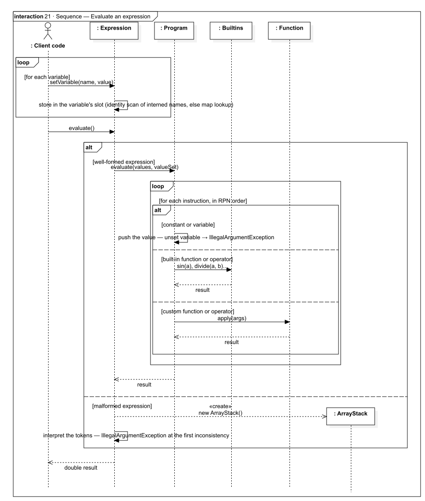
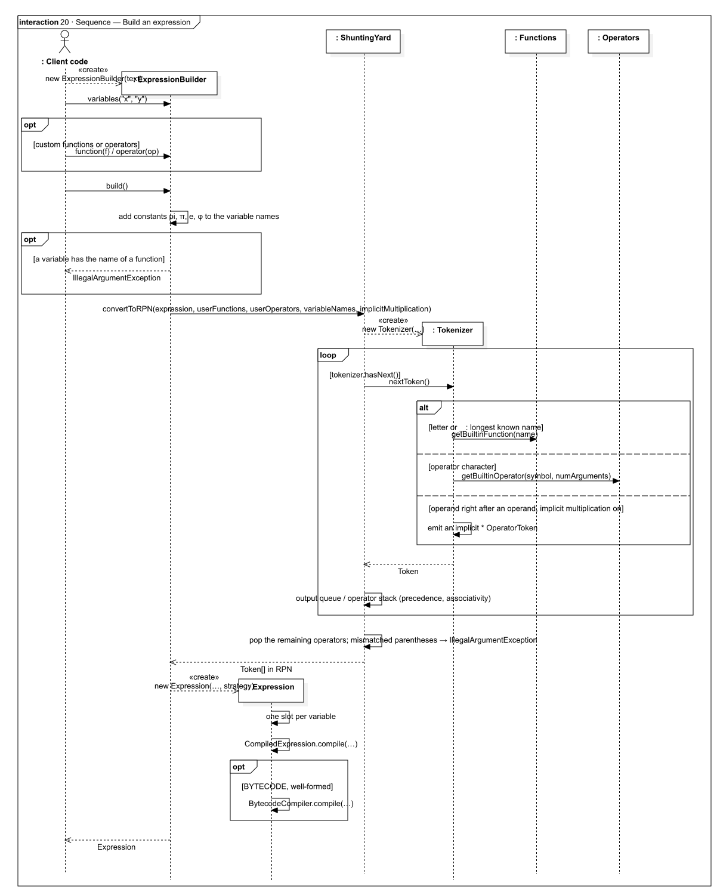
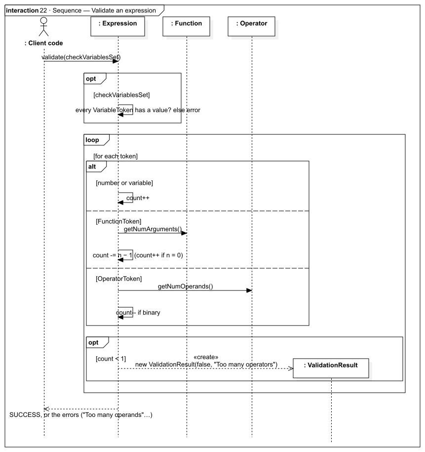
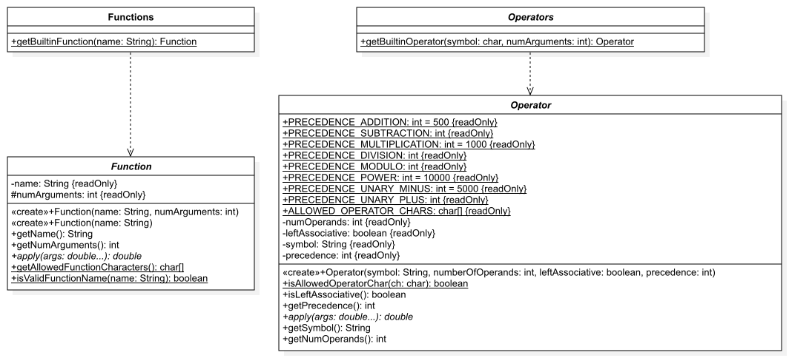
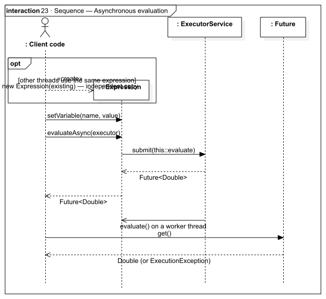
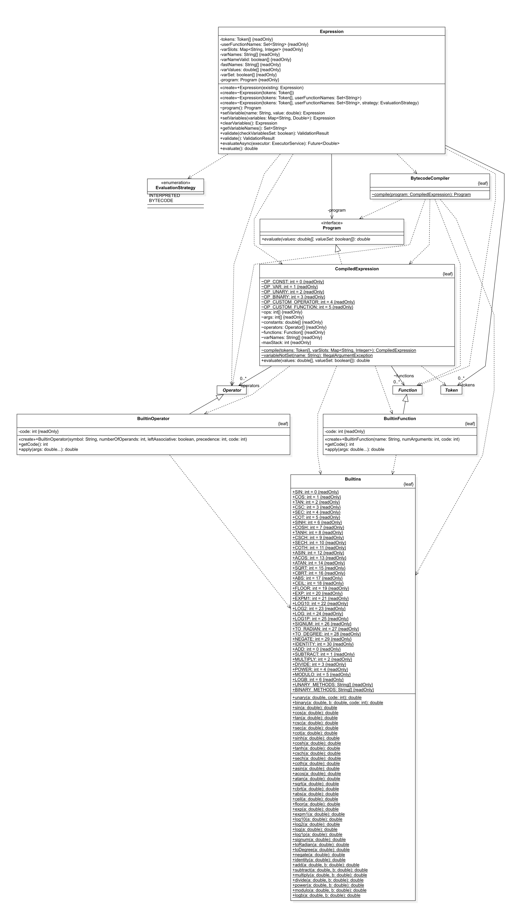

# exp4j — Architecture and Developer Guide

exp4j evaluates mathematical expressions written as text, such as `3 sin(x) - 2 / (y - 2)`. It is a small library that needs nothing at runtime except the JDK.

This document explains how the library is built, how to use it, and how to extend it. The UML model is in [`uml/exp4j.mdj`](uml/exp4j.mdj) (StarUML). See [`uml/README.md`](uml/README.md) for the list of diagrams.



---

## 1. Quick start

```java
Expression e = new ExpressionBuilder("3 * sin(y) - 2 / (x - 2)")
        .variables("x", "y")
        .build()
        .setVariable("x", 2.3)
        .setVariable("y", 3.14);
double result = e.evaluate();
```

The library has three steps:

1. **Configure** an `ExpressionBuilder`: the expression text, the variable names, and optionally your own functions and operators, and the evaluation strategy.
2. **`build()`** parses the text once into an `Expression` and compiles it for evaluation.
3. **Evaluate** the `Expression` as many times as needed, with new variable values each time.

For an expression evaluated many times, generate bytecode for it (see §9):

```java
Expression e = new ExpressionBuilder("3 * sin(y) - 2 / (x - 2)")
        .variables("x", "y")
        .strategy(EvaluationStrategy.BYTECODE)
        .build();
```

---

## 2. Packages

| Package (`net.objecthunter.exp4j…`) | Classes | Role |
|---|---|---|
| *(root)* | `ExpressionBuilder`, `EvaluationStrategy`, `Expression`, `ValidationResult`; package-private `Program`, `CompiledExpression`, `BytecodeCompiler`, `ArrayStack` | Public API: build, validate and evaluate expressions. The package-private classes compile and run expressions (§3.3, §9). |
| `.tokenizer` | `Tokenizer`, `Token`, `NumberToken`, `VariableToken`, `FunctionToken`, `OperatorToken`, `OpenParenthesesToken`, `CloseParenthesesToken`, `ArgumentSeparatorToken`, `UnknownFunctionOrVariableException` | Lexical analysis: splits the text into tokens. |
| `.shuntingyard` | `ShuntingYard` | Converts infix tokens to reverse Polish notation (RPN) with Dijkstra's shunting-yard algorithm. |
| `.function` | `Function` (abstract), `Functions` | Extension point for functions, plus the 31 built-in functions. |
| `.operator` | `Operator` (abstract), `Operators` | Extension point for operators, plus the 8 built-in operators. |
| `.internal` *(not exported)* | `Builtins`, `BuiltinFunction`, `BuiltinOperator` | The single implementation of every built-in function and operator, used by `Functions`, `Operators` and both evaluation strategies. |



Dependencies point downward: the API depends on everything else. `function` and `operator` depend only on `internal`, which depends on `function` and `operator` for the two base classes it extends.

**Java module.** The jar is the named module `net.objecthunter.exp4j` (`src/main/java/module-info.java`). It requires only `java.base` and exports five packages: the root package, `.function`, `.operator`, `.tokenizer` and `.shuntingyard`. `.internal` is not exported, so on the module path its classes are not accessible to applications.

```java
module my.app {
    requires net.objecthunter.exp4j;
}
```

---

## 3. How an expression is processed

```
 "3 sin(x) - 2"                                                      double
       │                                                                ▲
       ▼                                                                │
  ┌──────────┐  infix tokens  ┌──────────────┐  Token[] (RPN)  ┌──────────────┐
  │Tokenizer │ ─────────────▶ │ ShuntingYard │ ──────────────▶ │  Expression  │
  └──────────┘                └──────────────┘                 │  + Program   │
   names, numbers,             precedence,                     └──────────────┘
   unary vs binary,            associativity,                   variable slots,
   implicit '*'                parentheses                      compiled program
```

`ExpressionBuilder.build()` runs the first two steps. The `Expression` constructor then compiles the RPN tokens into a `Program` (§3.3).



### 3.1 Tokenizing — `Tokenizer`

`Tokenizer.nextToken()` reads one token at a time. The type of the previous token (`lastToken`) decides how the next characters are read:

| Input | Token produced | Rules |
|---|---|---|
| Digits, `.`, scientific notation (`1.5e-3`) | `NumberToken` | A trailing `e`/`E` is not part of the number (so `2e` is `2 · e`). A number directly after a number is an error. |
| Letters, digits, `_`, `.` | `VariableToken` or `FunctionToken` | Greedy: the **longest** prefix that is a declared variable or a known function is used. Declared variables take priority over functions. If nothing matches, `UnknownFunctionOrVariableException` is thrown. |
| Operator characters | `OperatorToken` | The longest run of allowed characters that matches a user operator wins. For a built-in `+` or `-`, the operator is **unary** at the start, after `(`, after `,`, or after a binary or prefix operator. Otherwise it is **binary**. |
| `(` `[` `{` | `OpenParenthesesToken` | All three bracket styles are equivalent. |
| `)` `]` `}` | `CloseParenthesesToken` | |
| `,` | `ArgumentSeparatorToken` | Separates function arguments. |

**Implicit multiplication.** This is on by default; turn it off with `ExpressionBuilder.implicitMultiplication(false)`. A `*` is inserted when a number, a name, or `(` comes right after an operand: `2x`, `2(x+1)`, `(a)(b)`, `x y`. The character that triggers it is read again on the next call.



### 3.2 Reordering — `ShuntingYard.convertToRPN`

This is the classic algorithm with one output queue and one operator stack:

- Numbers and variables go straight to the output.
- Functions and `(` are pushed onto the stack.
- An operator `o1` first pops every operator `o2` on the stack that has higher precedence, or equal precedence when `o1` is left-associative. A unary operator never pops a binary one.
- `,` pops operators up to the enclosing `(`.
- `)` pops operators up to `(`, removes the `(`, then pops the function if one is on top.
- At the end, the remaining operators are popped. A leftover parenthesis means the parentheses are mismatched, and an `IllegalArgumentException` is thrown.

### 3.3 Compiling and evaluating — `Expression`

When an `Expression` is created, it prepares everything that does not depend on variable values:

1. **Variable slots.** Each distinct variable name gets an index into a `double[]` of values and a `boolean[]` of "has a value" flags. The names are interned, so `setVariable("x", …)` with a string literal finds its slot by an identity comparison, without hashing. Other strings fall back to a map lookup.
2. **`CompiledExpression.compile`** turns the RPN tokens into a flat list of instructions: push a constant, push a variable, apply a built-in (by its `Builtins` code), apply a custom operator or function. It also simulates the operand stack. If the tokens are malformed (too many operators or operands, a function without enough arguments), it returns `null` instead.
3. With `EvaluationStrategy.BYTECODE`, **`BytecodeCompiler`** translates that instruction list into JVM bytecode (§9).

`evaluate()` then runs the `Program`:

| Instruction | Action |
|---|---|
| constant | push its value |
| variable | push the value from its slot; `IllegalArgumentException` if it has none |
| built-in operator or function | apply it to the 1 or 2 values on top of the stack, through `Builtins` |
| custom operator | pop 1 or 2 operands, push `operator.apply(...)` |
| custom function | pop `numArguments` values (the last popped is the last argument), push `function.apply(...)` |

At the end exactly one value is left, and it is the result.

**Malformed expressions** have no `Program`. `evaluate()` then interprets the tokens one by one on an `ArrayStack`, as earlier versions did, and throws the same `IllegalArgumentException` at the first inconsistency. `validate()` reports these problems without evaluating.



---

## 4. Public API reference

### `ExpressionBuilder`

| Method | Description |
|---|---|
| `ExpressionBuilder(String expression)` | Throws `IllegalArgumentException` if the expression is null or blank. |
| `variable(String)`, `variables(String...)`, `variables(Set<String>)` | Declares variable names. **A name must be declared to be recognized.** |
| `function(Function)`, `functions(Function...)`, `functions(List<Function>)` | Adds user functions. A user function overrides a built-in one with the same name. |
| `operator(Operator)`, `operator(Operator...)`, `operator(List<Operator>)` | Adds user operators. The symbol is checked against `Operator.ALLOWED_OPERATOR_CHARS`. |
| `implicitMultiplication(boolean)` | Turns implicit `*` on or off (default: `true`). |
| `strategy(EvaluationStrategy)` | `INTERPRETED` (default) or `BYTECODE`. See §9. Throws `IllegalArgumentException` for `null`. |
| `build()` | Adds the constants, rejects variables named like a function, parses the text and compiles it into an `Expression`. |



### `Expression`

| Method | Description |
|---|---|
| `setVariable(String, double)`, `setVariables(Map<String, Double>)` | Sets values and returns `this` for chaining. Rejects names that clash with a function. |
| `clearVariables()` | Removes **all** values, including the constants `pi`, `π`, `e` and `φ`. |
| `getVariableNames()` | The variables used in the expression (constants included if they appear in it). |
| `validate()` / `validate(boolean checkVariablesSet)` | Checks the expression without evaluating it. See §6. |
| `evaluate()` | Returns the result as a `double`. |
| `evaluateAsync(ExecutorService)` | Submits `evaluate()` to the executor and returns a `Future<Double>`. |
| `Expression(Expression existing)` | Copy constructor: shares the parsed tokens and the compiled program, and copies the variable values. |

### `EvaluationStrategy`

| Value | Use it when |
|---|---|
| `INTERPRETED` | The default. Building is cheap. Best for expressions evaluated a few times, or when many different expressions are built. |
| `BYTECODE` | The expression is evaluated many times. Building costs more (class generation and JIT warm-up), but evaluation runs close to hand-written Java. Falls back to `INTERPRETED` where classes cannot be defined at runtime. |

### `ValidationResult`

`isValid()` and `getErrors()`. `ValidationResult.SUCCESS` is a shared instance, and its `getErrors()` returns `null`.

---

## 5. Built-in elements

### Constants

These are predefined variables. Overriding them with `setVariable` is allowed.

| Name | Value |
|---|---|
| `pi`, `π` | `Math.PI` |
| `e` | `Math.E` |
| `φ` | 1.618033988749895, the golden ratio (1 + √5) / 2 |

### Operators (`Operators`)

| Symbol | Arity | Precedence | Associativity | Notes |
|---|---|---|---|---|
| `+` `-` | 2 | 500 | left | |
| `*` `/` `÷` `%` | 2 | 1000 | left | `/` and `%` throw `ArithmeticException` when dividing by zero |
| unary `-` `+` | 1 | 5000 | right | |
| `^` | 2 | 10000 | right | `2^3^2` = `2^9`. Because `^` has higher precedence than unary minus, `-2^2` = `-4`. |

The precedence values are public constants on `Operator` (`PRECEDENCE_ADDITION`, `PRECEDENCE_POWER`, …), so custom operators can be placed relative to them.

### Functions (`Functions`)

| Category | Functions |
|---|---|
| Trigonometric | `sin` `cos` `tan` `cot` `sec` `csc` `asin` `acos` `atan` |
| Hyperbolic | `sinh` `cosh` `tanh` `coth` `sech` `csch` |
| Powers and roots | `sqrt` `cbrt` `pow(x, y)` `exp` `expm1` |
| Logarithms | `log` (natural) `log10` `log2` `log1p` `logb(base, x)` |
| Rounding and sign | `abs` `ceil` `floor` `signum` |
| Angle conversion | `toradian` `todegree` |

`cot`, `sec` and `csc` throw `ArithmeticException` when their denominator is zero. `csch(0)` returns `0`.

> **Known issue.** The built-in `logb` cannot be used in an expression. `Functions` creates it, but `Functions.getBuiltinFunction` has no `case "logb"`, so the tokenizer only recognizes `log` and then fails on `b` with `UnknownFunctionOrVariableException`. A user function named `logb` (registered with `ExpressionBuilder.function`) works.

---

## 6. Validation and errors

`validate(checkVariablesSet)` does two checks without evaluating anything:

1. If `checkVariablesSet` is true, it checks that every variable in the expression has a value.
2. It checks that operands and operators balance. A counter goes up for each operand and down for each binary operator. A function with *n* arguments lowers it by *n − 1*, and a zero-argument function raises it by 1. The counter must never drop below 1 and must end at exactly 1. Otherwise validation reports `Too many operators` or `Too many operands`.



| Situation | Exception | Thrown by |
|---|---|---|
| Empty expression | `IllegalArgumentException` | `ExpressionBuilder` constructor |
| Variable named like a function | `IllegalArgumentException` | `build()`, `setVariable()` |
| Invalid operator symbol | `IllegalArgumentException` | `ExpressionBuilder.operator()` |
| Invalid function name, or negative number of arguments | `IllegalArgumentException` | `Function` constructor |
| Unknown name | `UnknownFunctionOrVariableException` (an `IllegalArgumentException`) with `getToken()` and `getPosition()` | `Tokenizer`, during `build()` |
| Unparsable character, or a number right after a number | `IllegalArgumentException` | `Tokenizer` |
| Mismatched parentheses, misplaced `,` | `IllegalArgumentException` | `ShuntingYard` |
| Variable without a value, wrong number of operands or arguments | `IllegalArgumentException` | `evaluate()` |
| Division by zero (`/`, `%`, `cot`, `sec`, `csc`) | `ArithmeticException` | `evaluate()` |

---

## 7. Extending exp4j

### Custom function

```java
Function avg = new Function("avg", 3) {
    @Override
    public double apply(double... args) {
        return (args[0] + args[1] + args[2]) / 3;
    }
};
double r = new ExpressionBuilder("avg(1, 2, x)").function(avg).variables("x").build()
        .setVariable("x", 6).evaluate();   // 3.0
```

- A name starts with a letter or `_` and may then contain letters, digits and `_`.
- The number of arguments must be ≥ 0, and the default is 1. A function with 0 arguments is called as `f()`.

### Custom operator

```java
Operator factorial = new Operator("!", 1, true, Operator.PRECEDENCE_POWER + 1) {
    @Override
    public double apply(double... args) {
        // ...
    }
};
new ExpressionBuilder("3!").operator(factorial).build().evaluate();  // 6.0
```

- Symbols use only these characters: `+ - * / % ^ ! # § $ & ; : ~ < > | = ÷ √ ∛ ⌈ ⌊`.
- An operator with 1 operand that is **left-associative** acts as a postfix operator (`3!`). One that is **right-associative** acts as a prefix operator (`√4`).
- A symbol made of several characters (for example `>=`) is matched greedily.

Custom functions and operators run through `apply(double...)` with both strategies, so each call allocates its argument array. Built-ins don't.

### Adding a built-in function or operator

Built-ins are defined once, in `internal/Builtins.java`:

1. Add a `public static double name(double a)` (or `(double a, double b)`) method with the math. Keep it small (at most 35 bytes of bytecode) so the JIT always inlines it, and move any exception construction to a helper if needed.
2. Add a code constant and a `case` in `unary()` or `binary()` that calls the method.
3. Add the method name at the code's index in `UNARY_METHODS` or `BINARY_METHODS`. The bytecode generator calls the method by this name. `BuiltinsTest` checks that the table and the switch agree.
4. Register it in `Functions` (`new BuiltinFunction(name, numArguments, code)`) or `Operators` (`new BuiltinOperator(...)`).

The interpreter and the bytecode generator pick it up automatically.



---

## 8. Thread safety

- `Function` and `Operator` instances, including the built-ins, have no state and can be shared between threads.
- An `Expression` stores its variable values in mutable arrays. Do not call `setVariable` from several threads on the same instance. Give each thread its own copy with `new Expression(existing)`; the copy is cheap because the tokens and the compiled program, including generated bytecode, are shared.
- The compiled `Program` has no state: variable values are passed to it on each call, and the interpreter allocates its stack per call. So concurrent `evaluate()` calls on an instance whose variables no longer change are safe.



---

## 9. Evaluation strategies and performance



### `INTERPRETED` — `CompiledExpression`

`CompiledExpression.evaluate` runs the instruction list in a loop with a `switch` on the opcode and a `double[]` stack. Built-ins are dispatched with `Builtins.unary(a, code)` / `Builtins.binary(a, b, code)`. Nothing is allocated per instruction, and only custom functions and operators get an argument array.

### `BYTECODE` — `BytecodeCompiler`

`BytecodeCompiler.compile` writes a class with the `java.lang.classfile` API and defines it with `MethodHandles.Lookup.defineHiddenClass`. Its `evaluate(double[] values, boolean[] valueSet)` method is straight-line code:

- constants are loaded with `ldc`;
- each variable is checked and copied into a local variable at its **first** use, in RPN order, so a missing value is reported exactly where the interpreter would report it;
- each built-in is an `invokestatic` of its own method in `Builtins` (`Builtins.cos(D)D`, `Builtins.divide(DD)D`, …), which the JIT inlines;
- custom operators and functions are called through `apply(double...)` on instances held by the generated object.

The hidden class is in the library's own package and module, and is unloaded when its `Expression` (and all copies) are no longer reachable.

**Fallback.** If the class cannot be defined, `compile` returns `null` and the expression uses the interpreter. This happens in a GraalVM native image, which cannot define classes at runtime and reports it with an `Error`. Only `VirtualMachineError`s (out of memory, stack overflow) are rethrown.

**jlink.** The strategy needs only `java.base` (`java.lang.classfile`, `java.lang.constant`, `java.lang.invoke`). It works in a runtime image built with `jlink --add-modules <your module>` (tested with `--strip-debug --no-header-files --no-man-pages`).

### Why the code is shaped this way

These choices keep evaluation fast, including in applications that use many different expressions:

- **One small method per built-in.** The JIT inlines methods of at most 35 bytes of bytecode at every call site, and larger ones only at hot sites and only if their compiled code is not already big. A single large `switch` stopped being inlined once many different built-ins had been used: `-XX:+PrintInlining` showed *already compiled into a big method*. Calling the small method directly from generated bytecode avoids this.
- **`setVariable` is tiny.** Its fast path is an identity scan over at most 16 interned names. The rest (map lookup, name check) is in a separate method, so the JIT can inline the fast path at call sites.
- **No boxing, no map lookups, no per-call varargs arrays** for built-ins: variables live in `double[]` slots.

### Measuring

`PerformanceTest` evaluates `log(x) - y * (sqrt(x^cos(y)))` for 2 seconds per implementation. It reports evaluations per second and the percentage of the same formula written with `java.lang.Math`. Every result is accumulated into a `volatile` field, otherwise the JIT removes the `Math` computation as dead code and the baseline is inflated about 2.7×. Typical results on JDK 26:

| Implementation | % of `Math`, run alone | % of `Math`, in `mvn verify` |
|---|---|---|
| exp4j interpreted | ~60 % | ~53 % |
| exp4j bytecode | ~88 % | ~87 % |

Results are lower when the test runs in the same JVM after the other tests. The JIT optimizes from the profile it has collected, and the other tests exercise every built-in and many generated classes. A real application that builds many different expressions is closer to this case.

**Compiler options do not help.** `javac` does not optimize (its `-O` flag has had no effect for about 20 years), and all optimization is done by the JIT at runtime. JVM options such as `-XX:InlineSmallCode` affect the whole application, and the code above does not rely on them. JDK 24+ AOT caches (`-XX:AOTCache`) shorten start-up and warm-up, but do not change peak speed.

---

## 10. Building and testing

| | |
|---|---|
| Coordinates | `net.objecthunter:exp4j:0.4.20-SNAPSHOT` |
| Java | Compiled for release 26 (`maven.compiler.source/target` in `pom.xml`, branch `JDK26_Upgrade`) |
| Runtime dependencies | none |
| Test dependencies | JUnit 4.13.2, Logback 1.6.5, Nashorn 15.7 (for the JavaScript row of `PerformanceTest`) |

```bash
mvn test        # unit tests, including PerformanceTest (prints a benchmark table)
mvn package     # jar + sources jar + javadoc jar
mvn verify      # the same; add -Prelease to sign the artifacts with GPG
```

Notes on the build configuration:

- `maven-gpg-plugin` signs the artifacts only in the `release` profile (`-Prelease`), which needs a GPG key.
- The test classes are compiled into the module. `maven-compiler-plugin` adds `java.scripting` for test compilation only, because `PerformanceTest` uses `javax.script` and the library does not.
- The `attach-javadocs` execution builds the javadoc jar with `doclint` enabled (`all,-missing`), so javadoc errors fail the build.
- The JDK no longer ships a JavaScript engine, so `PerformanceTest` gets one from the standalone Nashorn test dependency.

| Test class | Covers |
|---|---|
| `ExpressionBuilderTest` | Most of the syntax, functions, operators and error cases |
| `ExpressionTest`, `ExpressionValidateTest` | Evaluation, variables, validation |
| `FunctionsTest` | Function names and argument counts |
| `TokenizerTest`, `TokenizerUnknownTokenOrVariableTest` | Tokens, implicit multiplication, error positions |
| `ShuntingYardTest` | RPN conversion |
| `ArrayStackTest` | The internal stack |
| `BytecodeStrategyTest` | The `BYTECODE` strategy against the interpreter: every built-in (including NaN, ±∞, ±0), custom functions and operators, missing variables, copies, concurrency, fallback for malformed expressions |
| `internal.BuiltinsTest` | `UNARY_METHODS` / `BINARY_METHODS` match the `unary()` / `binary()` switches |
| `ConcurrencyTests` | Parallel evaluation |
| `PerformanceTest` | Benchmark of both strategies against `Math` (see §9) |
